# 1. Overview

This document describes the forms built for the Form Controls activity of the final project.
The project is a Java SE 17 desktop application with a Java Swing interface and a MySQL 8.0
database, as stated in Chapters 1 and 3. Swing controls are used as the equivalents of HTML
form controls, as the activity allows.

| Form | Activity type | Module (Chapter 2 numbering) | Users |
| --- | --- | --- | --- |
| New Order | Major form | 5.0 Customer Order Intake (IPO 5.1 to 5.4) | Operations Manager, Officer-in-Charge |
| Register New Employee | Major form | 11.0 Registration (IPO 11.2) | Operations Manager |
| Search Orders | Supporting form (search) | 12.0 Search (IPO 12.1 to 12.3) | Operations Manager, Officer-in-Charge |
| Production Monitoring | Supporting form (filter) | 9.0 Production Status Monitoring (IPO 9.1 to 9.4) | Operations Manager, Officer-in-Charge |

All four forms follow the same design:

- **Labels.** Every input has a visible label linked to it with `setLabelFor`, and most labels
  have an Alt key shortcut (the underlined letter).
- **Placeholder and helper text.** Text fields show a gray example while empty, and a short
  helper line under the input explains the expected format.
- **Validation in two layers.** The form checks its input before sending it. The service class
  checks it again, together with database checks such as unique usernames and duplicate orders.
  Both layers call the same rules in `validation/FieldRules.java`, so they cannot disagree.
- **Error messages.** On a failed submit, nothing is saved. Each invalid field gets a red border
  and an "Error:" line under it, a summary of all problems appears at the top, and the cursor
  moves to the first invalid field. Color is never the only signal.
- **Keyboard use.** Tab moves through the controls from top to bottom, then to the buttons,
  then to the results table. Enter runs the main button and Escape runs Cancel or Reset.
  Radio buttons change with the arrow keys, and Tab leaves text areas instead of typing a tab.
- **Screen readers.** Every input has an accessible name ("Customer name, required") and an
  accessible description (the helper text, or the error when there is one).
- **Data handling.** Every form uses real data: two forms save to MySQL, and two run queries and
  show the results in a table.

# 2. Major Form 1: New Order

**Purpose.** Records a customer order once, in one place, instead of copying it from Facebook,
Viber, Gmail, or phone notes into a Google Sheet and a logbook (Chapter 1, Specific Problem 1 and
Objective 1). The order is saved with the status New and becomes available to the other modules.

**Module.** Customer Order Intake (5.0): Customer Lookup (5.1), New Customer Registration (5.2),
Order Details Entry and Validation (5.3), and Order Record Creation (5.4).

## 2.1 Controls (18)

| # | Label | Control (Swing) | HTML equivalent | Required | Purpose |
| --- | --- | --- | --- | --- | --- |
| 1 | Customer name | `JTextField` with placeholder | Textbox | Yes | Person or company name |
| 2 | Contact number | `JTextField` that accepts digits and + only | Tel / textbox | Yes | Used with the name to find an existing customer |
| 3 | Email | `JTextField` | Email | No | Saved with a new customer record |
| 4 | Look Up Customer | `JButton` | Button | | Finds an existing customer (IPO 5.1) |
| 5 | Project type | `JComboBox` loaded from `project_types` | Select | Yes | Kind of drafting or printing work |
| 6 | Project description | `JTextArea` with live character count | Textarea | Yes | What the customer needs |
| 7 | Required output | `JTextField` | Textbox | No | Number of sets, size, paper |
| 8 | Deadline | `JSpinner` with a date model (YYYY-MM-DD) | Date | Yes | Primary key of the production queue |
| 9 | Urgency level | Three `JRadioButton`s loaded from `urgency_levels` | Radio buttons | Yes | Secondary key of the production queue |
| 10 | Special instructions | `JTextArea` | Textarea | No | Paper type, sheet size, other notes |
| 11 | Reference file | Read-only `JTextField` | Textbox (read-only) | No | Shows the chosen file path |
| 12 | Browse Reference File | `JButton` opening a `JFileChooser` | File upload | No | Picks a design or reference file |
| 13 | Remove File | `JButton` | Button | | Removes the chosen file |
| 14 | Customer ID | Hidden value set by Look Up Customer | Hidden field | | Links the order to the found customer |
| 15 | Encoded by | Hidden value from the logged-in user | Hidden field | | Records who encoded the order |
| 16 | Save Order | `JButton` (Enter) | Submit button | | Validates and saves |
| 17 | Clear Form | `JButton` | Reset button | | Empties every field |
| 18 | Cancel | `JButton` (Escape) | Button | | Closes the form, asking first if data was typed |

The date received is not an input. The system sets it when the order is saved, so it cannot be
typed wrongly.

## 2.2 Validation rules

| Field | Rule | Checked in | Message shown |
| --- | --- | --- | --- |
| Customer name | Required; 2 to 100 characters; letters, numbers, spaces, and . , ' & ( ) - only; at least one letter | Form and service | "Customer name must be 2 to 100 characters long." |
| Contact number | Required; 09 plus 9 digits, +639 plus 9 digits, or 02 plus 8 digits; stored as 09XXXXXXXXX | Typing filter, form, and service | "Enter a mobile number like 09171234567 or +639171234567, or a landline like 0281234567." |
| Email | Optional; name@domain.tld pattern; up to 100 characters | Form and service | "Enter an email address like name@example.com." |
| Project type | Required; must still be active in Maintenance | Form; service checks the database | "Choose a project type." |
| Project description | Required; 5 to 500 characters; typing stops at 500 | Typing filter, form, and service | "Project description must be at least 5 characters long." |
| Required output | Optional; up to 150 characters | Typing filter, form, and service | "Required output must be 150 characters or fewer." |
| Deadline | Required; a real date in YYYY-MM-DD form; today or later | Form and service | "The deadline cannot be earlier than today." or "Enter the deadline as YYYY-MM-DD." |
| Urgency level | Required; must still be active | Form; service checks the database | "Choose an urgency level." |
| Special instructions | Optional; up to 500 characters | Typing filter, form, and service | "Special instructions must be 500 characters or fewer." |
| Reference file | Optional; dwg, dxf, pdf, psd, jpg, jpeg, or png; the file must exist; path up to 500 characters | Form and service | "The file was not found. Check that the shared folder is reachable and choose the file again." |
| Customer record | A customer with the same name and contact number is reused, never created twice | Service | Shown on screen as the Look Up Customer result |
| Duplicate order | An open order of the same customer with the same description triggers a Yes or No question before saving | Service | "Order 1001 of this customer has the same project description and is still open. Save this as a separate new order anyway?" |
| Role | Only the Operations Manager and Officer-in-Charge may save orders | Service | "Your role (Production Staff) is not allowed to use this function." |

## 2.3 Data handling

`OrderIntakeService.save` runs one database transaction that inserts the customer (when new)
into `customers`, the order into `orders` with the stage New, the reference file name and
location into `reference_files`, a row in `status_history`, and rows in `activity_log`. If any
step fails, the whole transaction is rolled back. All statements are JDBC prepared statements.

## 2.4 Screenshots

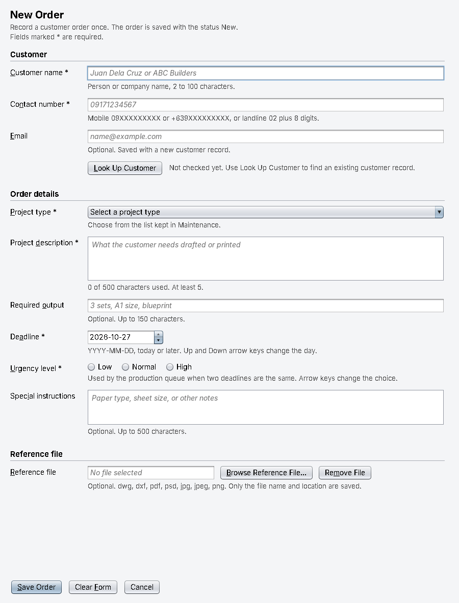

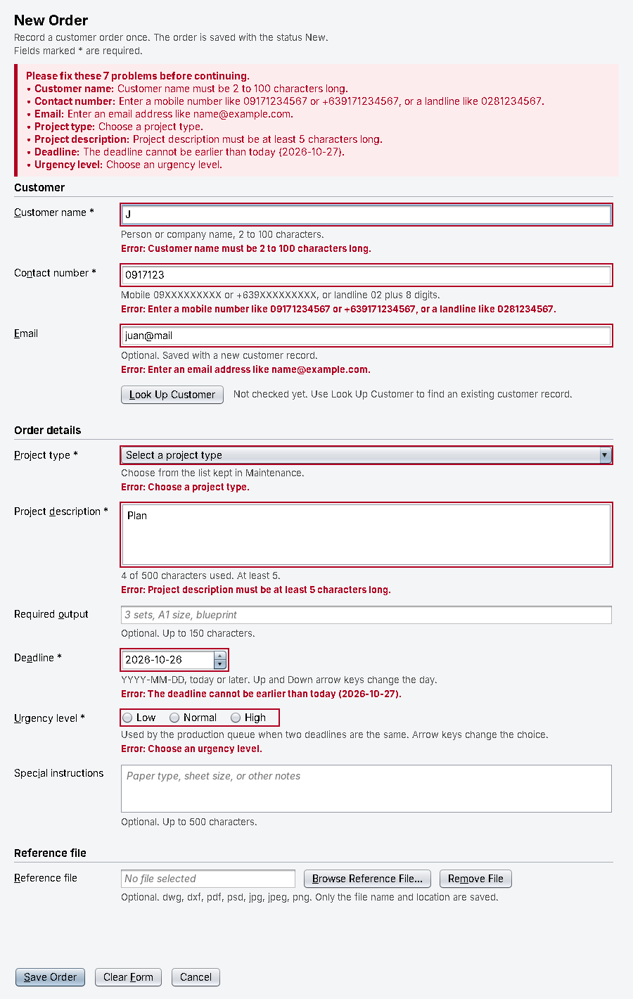

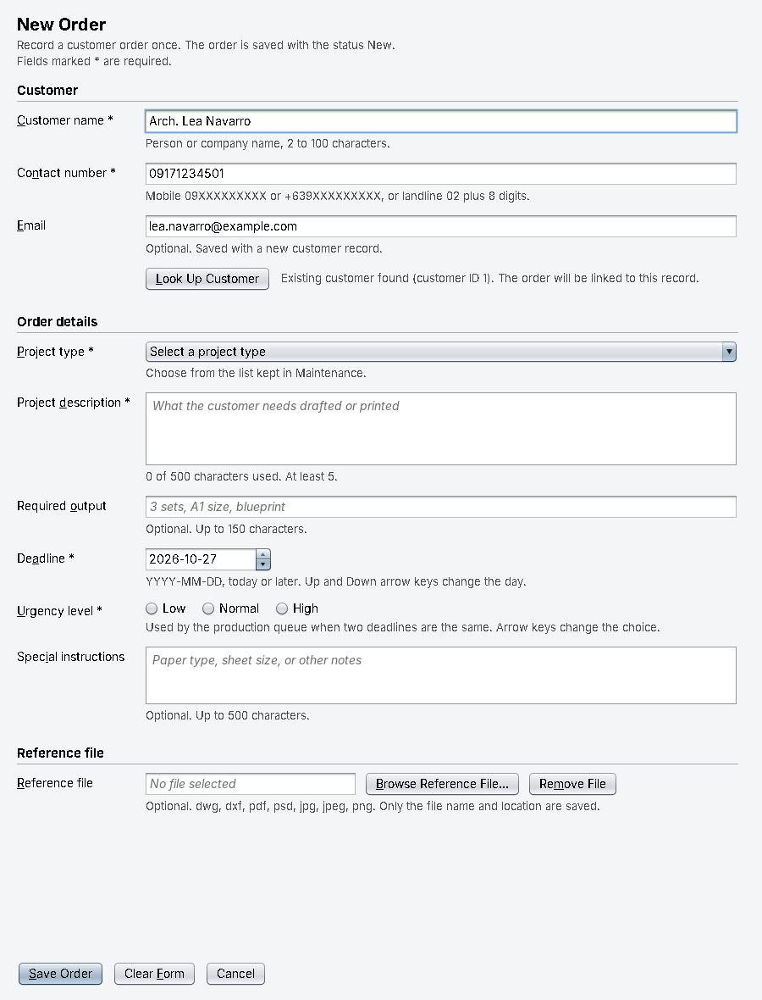

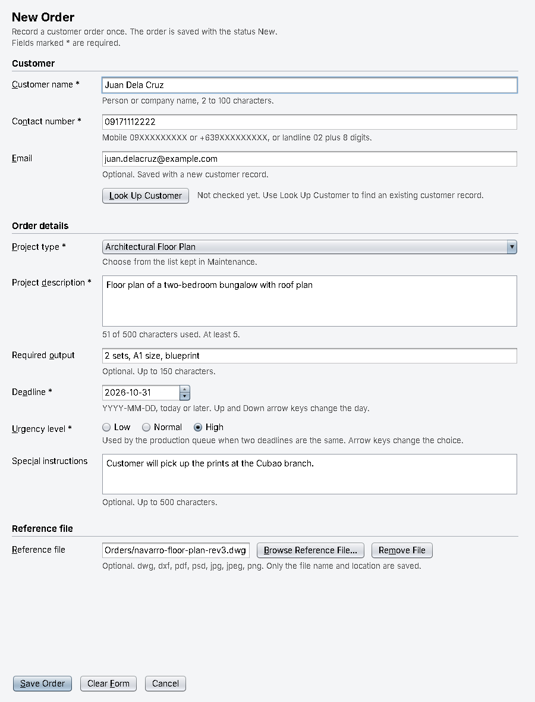

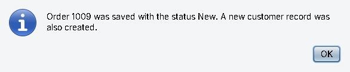

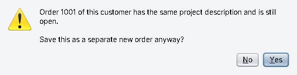

# 3. Major Form 2: Register New Employee

**Purpose.** Lets the Operations Manager create the login account of an employee, assign the
role that decides which menu the employee sees, and set an initial password (Chapter 1,
Registration module; Chapter 2, Figure 20).

**Module.** Registration (11.0), Register New Employee (IPO 11.2).

## 3.1 Controls (15)

| # | Label | Control (Swing) | HTML equivalent | Required | Purpose |
| --- | --- | --- | --- | --- | --- |
| 1 | First name | `JTextField` with placeholder | Textbox | Yes | Employee's first name |
| 2 | Last name | `JTextField` with placeholder | Textbox | Yes | Employee's last name |
| 3 | Role | Three `JRadioButton`s | Radio buttons | Yes | Operations Manager, Officer-in-Charge, or Production Staff |
| 4 | Position | `JComboBox`, enabled only for Production Staff | Select | For Production Staff | Designer, Drafter, or Modeler |
| 5 | Contact number | `JTextField` that accepts digits and + only | Tel / textbox | No | Employee contact |
| 6 | Email | `JTextField` | Email | No | Employee email |
| 7 | Username | `JTextField` that accepts letters, digits, . and _ | Textbox | Yes | Login name |
| 8 | Password | `JPasswordField` | Password | Yes | Initial password |
| 9 | Confirm password | `JPasswordField` | Password | Yes | Catches typing mistakes |
| 10 | Show passwords | `JCheckBox` | Checkbox | | Shows the typed passwords |
| 11 | Account status | `ToggleSwitch` (a styled `JToggleButton`) | Switch / toggle | | Active or Inactive; inactive accounts cannot log in |
| 12 | Created by | Hidden value from the logged-in user | Hidden field | | Records who created the account |
| 13 | Register Employee | `JButton` (Enter) | Submit button | | Validates and saves |
| 14 | Clear Form | `JButton` | Reset button | | Empties every field |
| 15 | Cancel | `JButton` (Escape) | Button | | Closes the form, asking first if data was typed |

## 3.2 Validation rules

| Field | Rule | Checked in | Message shown |
| --- | --- | --- | --- |
| First name, Last name | Required; 2 to 50 characters; letters, spaces, periods, apostrophes, and hyphens only | Typing filter, form, and service | "First name may use letters, spaces, periods, apostrophes, and hyphens only." |
| Role | Required | Form and service | "Choose the role of this employee." |
| Position | Required when the role is Production Staff; must be Designer, Drafter, or Modeler | Form and service | "Choose Designer, Drafter, or Modeler." |
| Contact number | Optional; same formats as the New Order form | Typing filter, form, and service | "Enter a mobile number like 09171234567 ..." |
| Email | Optional; name@domain.tld pattern | Form and service | "Enter an email address like name@example.com." |
| Username | Required; 4 to 30 characters; starts with a letter; letters, numbers, periods, and underscores | Typing filter, form, and service | "Username must be 4 to 30 characters long." |
| Username | Must not already exist (letter case ignored); checked again inside the save transaction | Service (database) | "This username is already taken. Choose another one." |
| Password | Required; 8 to 64 characters; at least one letter and one number; not the same as the username | Form and service | "Password must contain at least one letter and one number." |
| Confirm password | Must match the password | Form and service | "The two passwords do not match." |
| Role of the user | Only the Operations Manager may register accounts | Service | "Your role (Officer-in-Charge) is not allowed to use this function." |

## 3.3 Data handling

The password is hashed with PBKDF2-HMAC-SHA256 at 600,000 iterations with a random salt for each
user (Chapter 3, System Architecture) before it reaches the database. The plain password is
never stored or logged, and the form clears the password arrays after use. `RegistrationService`
inserts the employee into `employees` and the account into `users` in one transaction and adds a
row to `activity_log`.

## 3.4 Screenshots

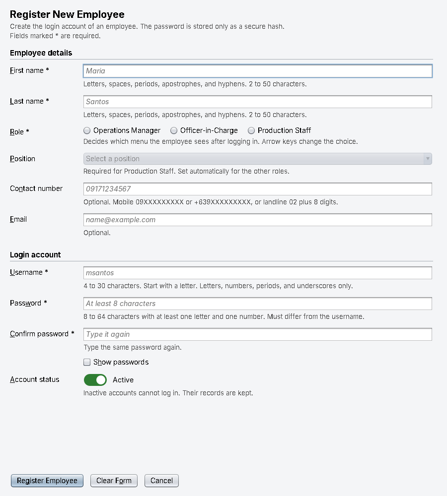

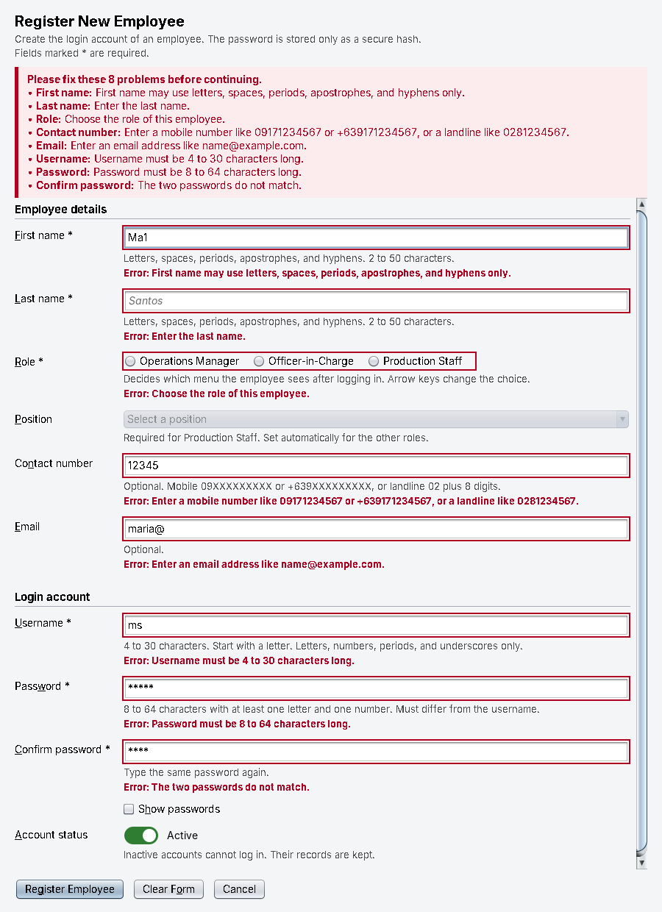

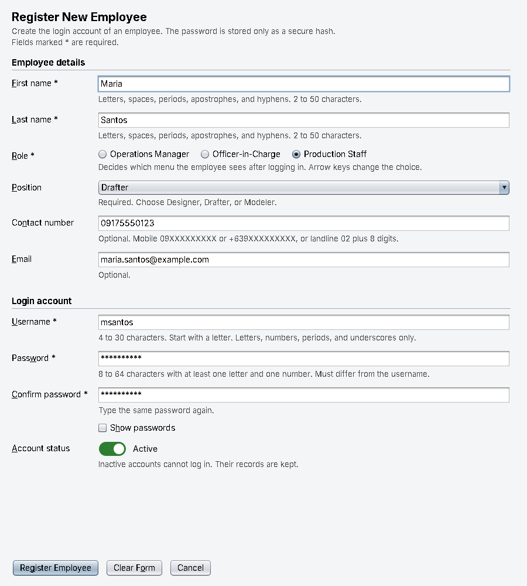

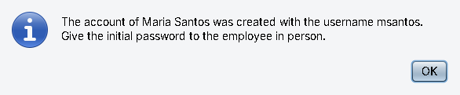

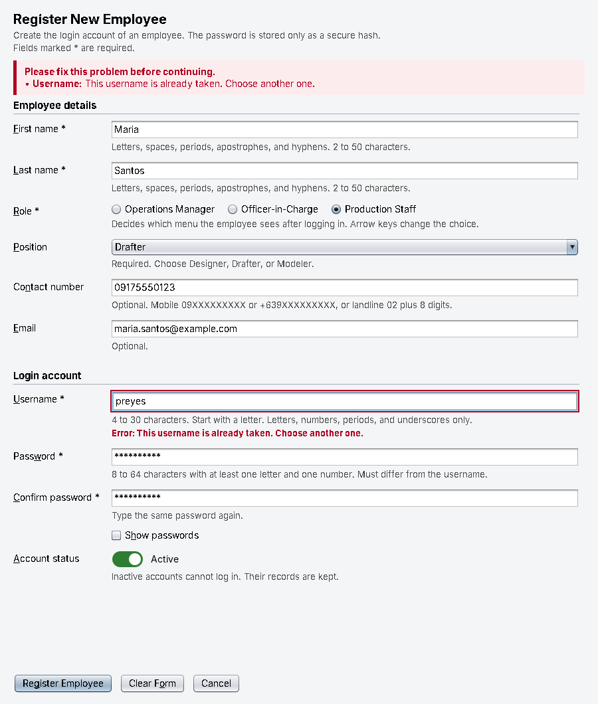

# 4. Supporting Form 1: Search Orders

**Purpose.** Finds past and current orders without scrolling through a spreadsheet or turning
the pages of a logbook (Chapter 1, Search module).

**Module.** Search (12.0): Enter Search Criteria (12.1), Run Search Query (12.2), and View
Selected Order Record (12.3).

## 4.1 Controls (13)

| # | Label | Control (Swing) | HTML equivalent | Purpose |
| --- | --- | --- | --- | --- |
| 1 | Search text | `JTextField` with placeholder | Search box | Partial match on order ID, customer name, or description |
| 2 | Project type | `JComboBox` with "All project types" | Select | Filter |
| 3 | Status | `JComboBox` with "All statuses" | Select | Filter by workflow stage |
| 4 | Assigned employee | `JComboBox` with "All employees" | Select | Filter by current assignee |
| 5 | Urgency level | `JComboBox` with "All urgency levels" | Select | Filter (the "priority level" filter of Chapter 1) |
| 6 | Include released and completed orders | `JCheckBox` | Checkbox | Closed orders are hidden unless ticked |
| 7 | Filter by date received | `JCheckBox` | Checkbox | Turns the date range on or off |
| 8 | Received from | `JSpinner` date | Date | Start of the range |
| 9 | Received to | `JSpinner` date | Date | End of the range |
| 10 | Search Orders | `JButton` (Enter) | Submit button | Runs the search |
| 11 | Reset Filters | `JButton` (Escape) | Reset button | Clears every filter |
| 12 | Results | `JTable`, sortable by column | Table | Shows the matching orders |
| 13 | View Selected Order | `JButton` (also Enter or double-click on a row) | Button | Opens the full order record (IPO 12.3) |

All filters are optional. Leaving everything blank lists the open orders.

## 4.2 Validation rules

| Field | Rule | Checked in | Message shown |
| --- | --- | --- | --- |
| Search text | Up to 100 characters | Typing filter, form, and service | "Search text must be 100 characters or fewer." |
| Received from | When the date filter is on: a real date, not later than today | Form and service | "The start date cannot be later than today." |
| Received to | When the date filter is on: a real date, not earlier than the start date | Form and service | "The end date cannot be earlier than the start date." |
| Status | Choosing Released or Completed requires the Include released and completed orders box | Form and service | "To search Completed orders, also tick Include released and completed orders." |
| Role | Operations Manager and Officer-in-Charge only | Service | "Your role (Production Staff) is not allowed to use this function." |

## 4.3 Data handling

`SearchService` turns the criteria into one parameterized SQL query (Chapter 3, Algorithm
Implementation). Percent signs and underscores typed by the user are escaped, so they are matched
as ordinary characters. The date range covers whole days from the start date to the end date.
At most 500 rows are returned, newest first, and the count is shown above the table.

## 4.4 Screenshots

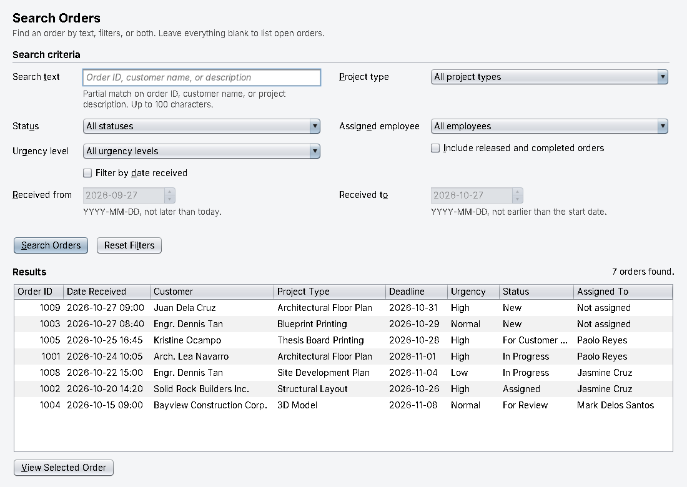

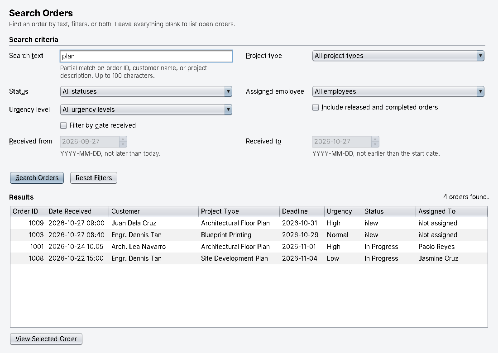

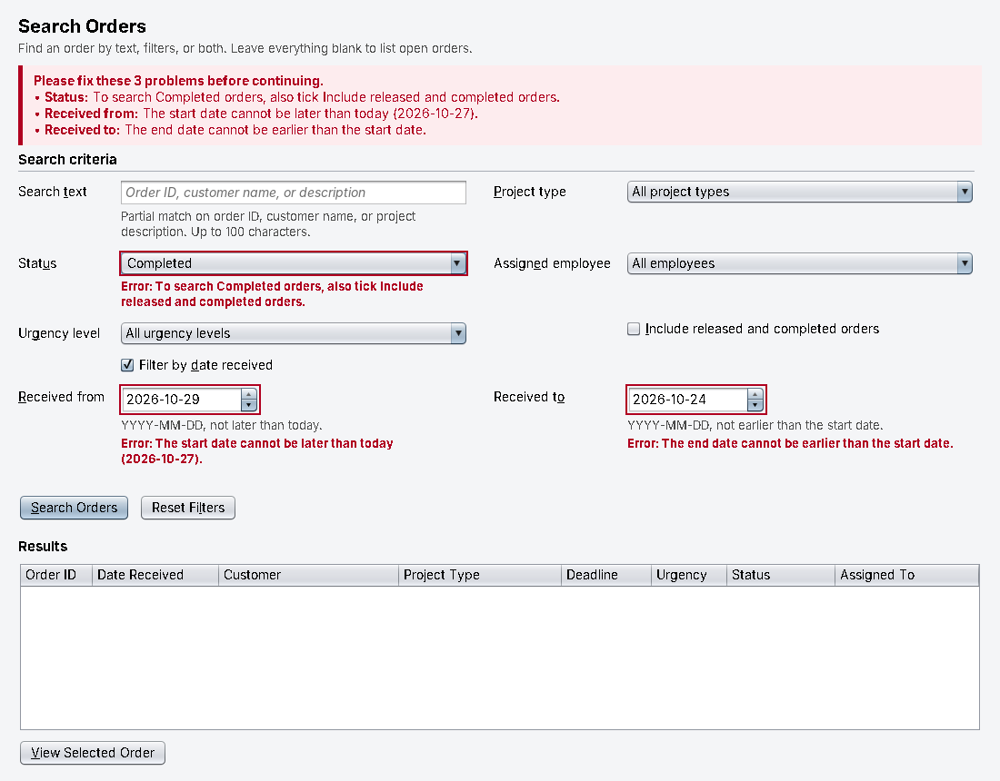

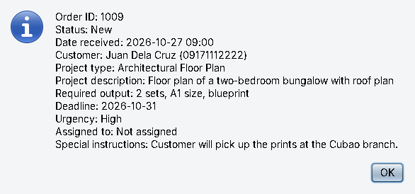

# 5. Supporting Form 2: Production Monitoring (Monitoring Filter)

**Purpose.** Shows the stage, assignee, and deadline indicator of every active order so the
Operations Manager and Officer-in-Charge no longer need to ask the assigned employee
(Chapter 1, Specific Problem 4 and Objective 4).

**Module.** Production Status Monitoring (9.0): Management Monitoring View (9.1), Active Orders
by Stage (9.2), Status Dashboard (9.3), and Deadline Indicators (9.4).

## 5.1 Controls (15)

| # | Label | Control (Swing) | HTML equivalent | Purpose |
| --- | --- | --- | --- | --- |
| 1 | Order ID or employee | `JTextField` with placeholder | Search box | Exact order ID, or part of an employee name (IPO 9.3) |
| 2 | Assigned employee | `JComboBox` with "All employees" | Select | Filter |
| 3 to 7 | Workflow stages | Five `JCheckBox`es: New, Assigned, In Progress, For Review, For Customer Confirmation | Checkboxes | Stages to show (IPO 9.2) |
| 8 to 11 | Deadline status | Four `JRadioButton`s: All, Passed Deadline, Approaching Deadline, On Schedule | Radio buttons | Filter by indicator (IPO 9.4) |
| 12 | Warning period | `JSlider` from 1 to 14 days with the value shown beside it | Range slider | The warning period entered by the user (IPO 9.4) |
| 13 | Apply Filters | `JButton` (Enter) | Submit button | Refreshes the table |
| 14 | Reset Filters | `JButton` (Escape) | Reset button | Restores the default filters |
| 15 | Active orders | `JTable`, sortable, with the deadline status as text on a tinted cell | Table | Results, with a count per stage above it |

## 5.2 Validation rules

| Field | Rule | Checked in | Message shown |
| --- | --- | --- | --- |
| Order ID or employee | Up to 60 characters | Typing filter, form, and service | "Order ID or employee name must be 60 characters or fewer." |
| Workflow stages | At least one stage ticked | Form and service | "Tick at least one workflow stage." |
| Workflow stages | Released and Completed are ignored even if sent, because they are not active | Service | Not shown; closed orders never appear |
| Warning period | 1 to 14 days (the slider cannot go outside this range, and the service checks again) | Slider limits and service | "Warning period must be 1 to 14 days." |
| Role | Operations Manager and Officer-in-Charge only | Service | "Your role (Production Staff) is not allowed to use this function." |

## 5.3 Data handling

`MonitoringService` reads the active orders with their current assignee and last status update.
For each order it computes the days remaining as the deadline minus the current date and applies
the rule in Chapter 3: below zero is Passed Deadline, within the warning period is Approaching
Deadline, and anything else is On Schedule. The form then shows the count of orders in each stage.

## 5.4 Screenshots

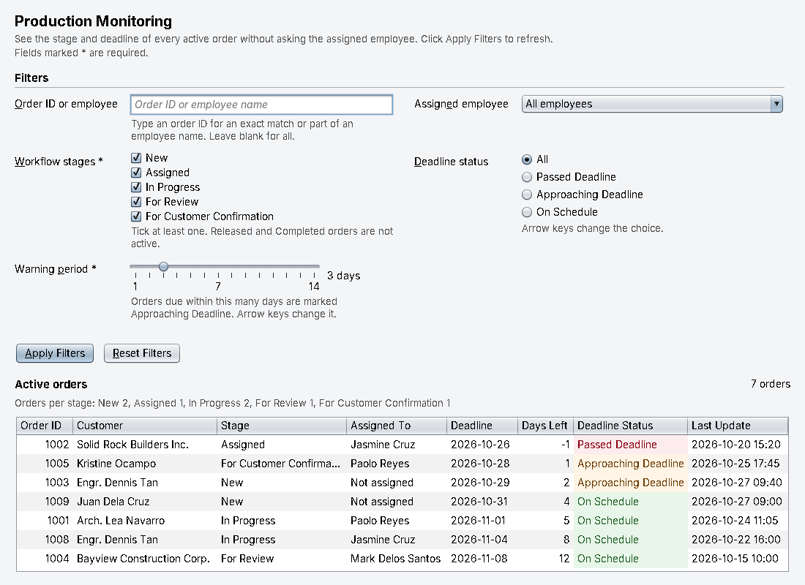

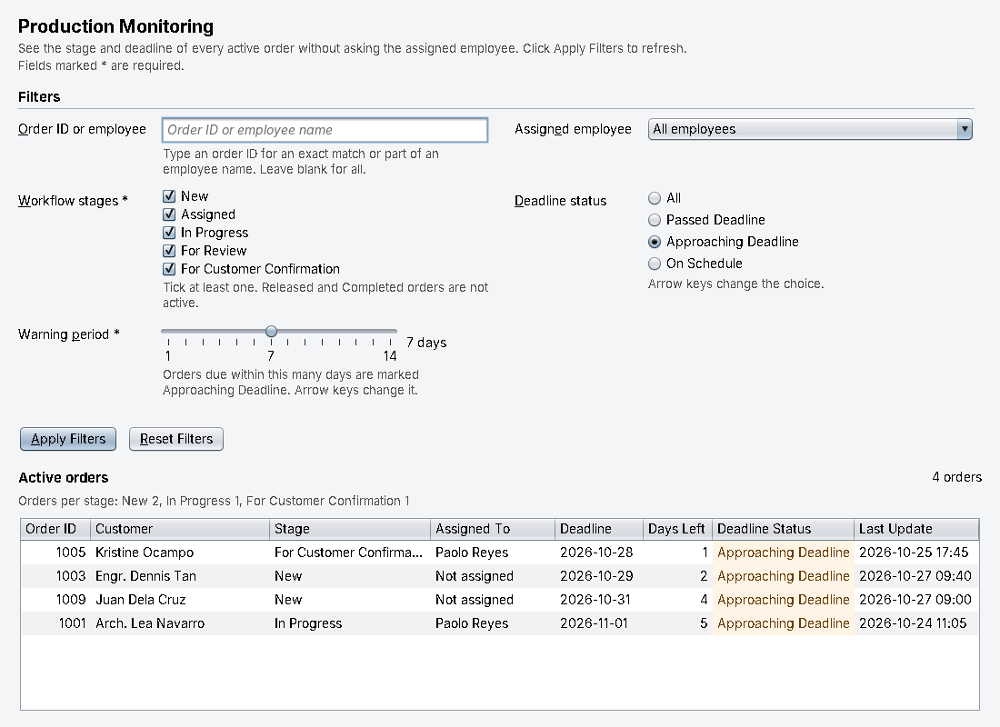

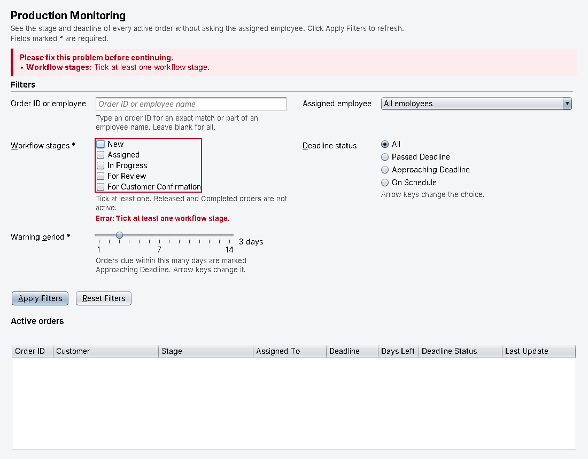

# 6. Login Form and Main Window

The Login form (IPO 1.1) uses the same layout and validation. A wrong password and an unknown
username show the same message, so the form does not reveal which usernames exist. Every login,
failed login, and logout is written to the activity log. After login, the main window shows only
the menu items of the user's role (Chapter 2, Figures 2 to 4).

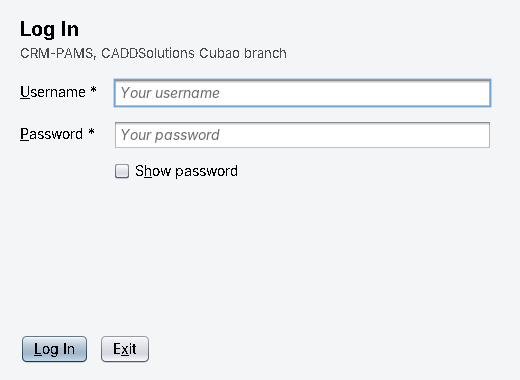

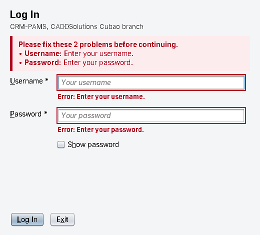

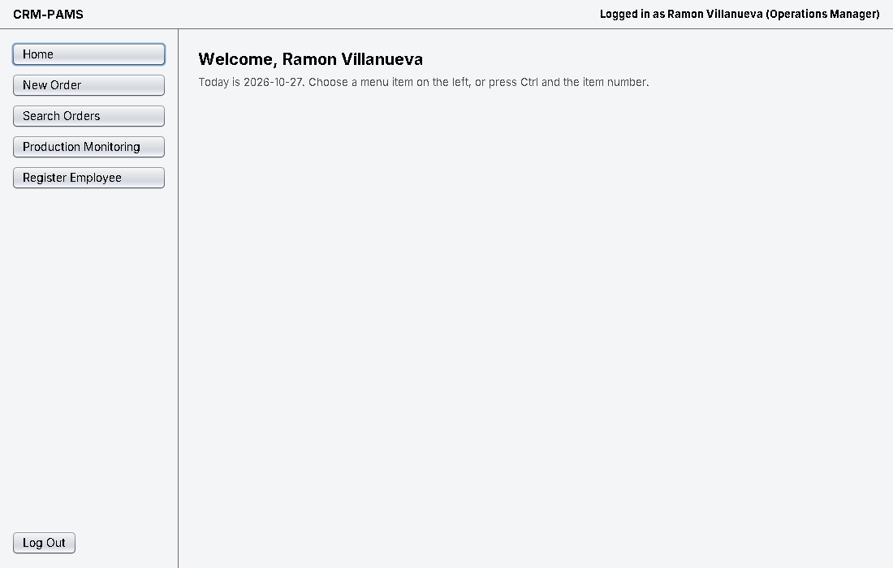

# 7. Testing

The validation rules and services are covered by JUnit 6 tests, following the black box and white
box approach in Chapter 3. The tests use an in-memory copy of the tables, so they run without a
MySQL server.

| Test class | What it checks |
| --- | --- |
| `FieldRulesTest` | Every rule with valid input, each invalid case, and boundary values (minimum and maximum lengths, deadline equal to today, end date equal to start date, warning period 1 and 14) |
| `PasswordHasherTest` | Correct and wrong passwords, random salt, 600,000 iterations by default |
| `DeadlineFlagTest` | Each branch of the deadline indicator rule |
| `LikeEscaperTest` | Percent signs and underscores are matched literally |
| `OrderIntakeServiceTest` | Saving a new customer and order together, reusing an existing customer, duplicate warning, closed orders not counted as duplicates, invalid input saving nothing, reference file name and location, role check |
| `RegistrationServiceTest` | Hashed password, position rule, unique username, matching passwords, role check |
| `SearchAndMonitoringServiceTest` | Text search, closed-status rule, date range, deadline flags, stage rule, role checks |
| `AuthServiceTest` | Each login outcome: missing input, wrong password, unknown user, deactivated account, success |
| `FormBehaviorTest` | Each form as a user would use it: invalid submit shows errors and saves nothing, valid submit saves, typing filters, at least 10 focusable controls per form, a label and accessible name for every input |

Result of the last run: 63 tests, all passed.

# 8. Directory Structure

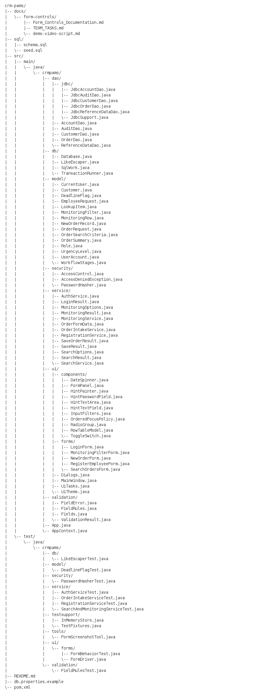

# 9. Items to Confirm Before Submission

These are design decisions made while building the forms. They do not change the six modules,
but the group should confirm them.

1. **Table and column names.** The database schema in `sql/schema.sql` was rebuilt from the
   written descriptions in Chapters 1 to 3. Compare it with Figure 89 (Entity Relationship
   Diagram) and rename columns to match the ERD where they differ.
2. **Email columns.** Email is stored for customers and employees as an optional field, based on
   "customer name and contact details" in Chapter 1. Remove it if the ERD has no email column.
3. **Project description is required** (5 to 500 characters), because the duplicate check
   compares descriptions. Chapter 1 names only customer, project type, and deadline as required.
4. **Photoshop files (psd)** were added to the accepted reference file types because the
   interview names PDF, AutoCAD, and Photoshop as the files clients send.
5. **Urgency levels** in the sample data are Low (1), Normal (2), and High (3). Chapter 3 uses
   Normal 2 and High 3; Low was added as the lowest level.
6. **Contact number formats** accept Philippine mobile numbers and Metro Manila landlines only.
